<div align="center">



<br /><br />

[](https://pabl0l.netlify.app)
[](https://github.com/Pabl0l)
[](mailto:jpom1310@gmail.com)
[](https://www.credly.com/users/juan-pablo-olivera-mendoza/badges)

<br />

<sub>11 proyectos &nbsp;·&nbsp; 16 certificaciones Cisco &nbsp;·&nbsp; Barranquilla, Colombia</sub>

</div>

<p align="center">──────────────&nbsp;&nbsp;◇&nbsp;&nbsp;──────────────</p>

```console
pablo@portfolio:~$ cat focus.txt
BMO · automatización para PYMES colombianas
Rust · seguridad ofensiva
Claude Code, OpenCode y Ollama dentro del flujo diario

pablo@portfolio:~$ ls stack/
python  typescript  rust  kotlin  react  astro  docker  cisco-ios
```

<div align="center">

### 01 &nbsp;— &nbsp;PERFIL

</div>

Técnico en mantenimiento de sistemas informáticos, egresado de la **Institución Universitaria de Barranquilla (2024–2026)**, con experiencia real en hardware, redes Cisco y desarrollo de software.

No solo arreglo computadoras: **construyo herramientas que eliminan trabajo repetitivo**. Cada proyecto nace de una necesidad concreta —un bot que lee comprobantes bancarios, una suite de ciberseguridad, un monitor de licitaciones públicas— y está pensado para que cualquiera con un PC pueda ejecutarlo.

Creo que la tecnología debe ser accesible: por eso lo que construyo es open source, está documentado y se sostiene sobre herramientas que ya existen.

<p align="center">──────────────&nbsp;&nbsp;◇&nbsp;&nbsp;──────────────</p>

<div align="center">

### 02 &nbsp;— &nbsp;PROYECTOS

<sub>ordenados por relevancia</sub>

</div>

| &nbsp; | Proyecto | Qué resuelve | Stack | Enlaces |
|:--|:---------|:-------------|:------|:--------|
| 01 | **[BMO](https://bmobot.co)** | Suite de automatización para PYMES: OCR de comprobantes bancarios, inventario, reportes y bot de WhatsApp para calificar leads | `Python` `React` `OCR` `WhatsApp` | [web](https://bmobot.co) · [instagram](https://www.instagram.com/bmobot.co/) |
| 02 | **[office2google](https://office2google.netlify.app)** | Doble click en un `.docx`, `.xlsx` o `.pptx` y se abre en Google Docs, Sheets o Slides, sin tocar el archivo original ni instalar Office | `TypeScript` `Bun` `Drive API` `Windows` | [web](https://office2google.netlify.app) · [código](https://github.com/Pabl0l/office2google) |
| 03 | **[Arsenal](https://github.com/Pabl0l/Arsenal)** | Suite de ciberseguridad con interfaz web que orquesta herramientas en Docker Kali, reporta con CVSS scoring y ofrece modo anónimo con Tor | `React` `FastAPI` `Docker` `Kali` | [código](https://github.com/Pabl0l/Arsenal) |
| 04 | **[Jack Sparrow](https://github.com/Pabl0l/jack-sparrow)** | CLI de pentesting web: SQLi, XSS, IDOR, SSRF y supply chain, con reportes en JSON, HTML y Markdown | `Rust` `Tokio` `Playwright` | [código](https://github.com/Pabl0l/jack-sparrow) |
| 05 | **[Monitoreo SECOP](https://github.com/Pabl0l/Monitoreo-de-Licitaciones-SECOP)** | Sigue licitaciones del SECOP II, descarga los pliegos, aplica OCR y detecta requisitos clave con un LLM local | `Python` `Ollama` `OCR` `Streamlit` | [código](https://github.com/Pabl0l/Monitoreo-de-Licitaciones-SECOP) |
| 06 | **[Merge Helper](https://marketplace.visualstudio.com/items?itemName=JuanPabloOliveraMendoza.merge-helper)** | Extensión de VS Code publicada en el Marketplace que detecta y fusiona bloques de código duplicados | `TypeScript` `VS Code` | [marketplace](https://marketplace.visualstudio.com/items?itemName=JuanPabloOliveraMendoza.merge-helper) · [código](https://github.com/Pabl0l/extension-merge-helper) |
| 07 | **[Facturador OCR](https://github.com/Pabl0l/Transcriptor-de-facturas-bancarias-por-OCR)** | Transcribe facturas de Nequi, Bancolombia y Daviplata, y las registra en Google Sheets con KPIs | `Python` `Tesseract` `Telegram` | [código](https://github.com/Pabl0l/Transcriptor-de-facturas-bancarias-por-OCR) |
| 08 | **ColombiaGuard** <sub>en desarrollo</sub> | Filtra llamadas antes de que suenen: las emergencias siempre pasan y, si el filtro falla, la llamada entra (*fail-safe*) | `Kotlin` `Compose` `Room` | sin enlace público |
| 09 | **[AutoVideo Studio](https://www.youtube.com/@blockedacc0unt)** | Genera, edita y publica video para redes sociales de forma completamente automatizada | `Python` `FFmpeg` `Playwright` | [canal](https://www.youtube.com/@blockedacc0unt) |
| 10 | **[Lead Finder](https://github.com/Pabl0l/Buscador-de-leads-con-google-maps)** | Extrae y clasifica prospectos desde Google Maps para automatizar el proceso comercial | `Python` `Scraping` | [código](https://github.com/Pabl0l/Buscador-de-leads-con-google-maps) |
| 11 | **[MinimalLauncher](https://github.com/Pabl0l/Minimal-Launcher)** | Launcher Android minimalista: rápido, sin anuncios y configurable | `Kotlin` `Java` | [código](https://github.com/Pabl0l/Minimal-Launcher) |

<sub>También publicados: [UniArauca](https://uniarauca.netlify.app) — MPA institucional · [dapNFC](https://dapnfc.netlify.app) — catálogo oficial · [Python scripts](https://github.com/Pabl0l/python) — utilidades sueltas</sub>

<p align="center">──────────────&nbsp;&nbsp;◇&nbsp;&nbsp;──────────────</p>

<div align="center">

### 03 &nbsp;— &nbsp;STACK

</div>

<div align="center">


</div>

<br />

| Área | Herramientas |
|:-----|:-------------|
| **Desarrollo web** | React · Next.js · Astro · TypeScript · JavaScript · Tailwind CSS · Vite |
| **Programación** | Python · Java · Rust · Kotlin · Bash |
| **Redes** | Cisco IOS (L2/L3) · VLANs · Routing & Switching · SSH · Packet Tracer |
| **Sistemas** | Linux · Windows · Docker · Git · VirtualBox |
| **Seguridad** | Pentesting web · Vulnerability Assessment · Hardening · Firewalls |
| **Inteligencia artificial** | Claude Code · OpenCode · Prompt Engineering · Ollama · LLM Automation |

<p align="center">──────────────&nbsp;&nbsp;◇&nbsp;&nbsp;──────────────</p>

<div align="center">

### 04 &nbsp;— &nbsp;TRAYECTORIA

</div>

**Técnico en Mantenimiento y Reparación de Sistemas Informáticos**
Mired IPS &nbsp;·&nbsp; `Oct 2025 — May 2026`

> Instalación y reparación física de equipos. Formateo, despliegue de sistemas operativos, backups y configuración de red. Configuración de redes LAN y mantenimiento de switches y routers. Soporte técnico a usuarios internos y mantenimiento de impresoras IP. Resolución de incidentes críticos con presencia en sitio.

<br />

**Técnico en Mantenimiento de Sistemas Informáticos**
Institución Universitaria de Barranquilla &nbsp;·&nbsp; `2024 — 2026` &nbsp;·&nbsp; Egresado

<br />

**16 certificaciones Cisco** &nbsp;·&nbsp; verificables en [Credly](https://www.credly.com/users/juan-pablo-olivera-mendoza/badges)

<details>
<summary>&nbsp;&nbsp;Ver el detalle de las certificaciones</summary>

<br />

**Ciberseguridad** — Hacker Ético · Gestión de Amenazas Cibernéticas · Defensa de la Red · Seguridad de Terminales · Introducción a la Ciberseguridad

**Redes** — CCNA: Conmutación, Enrutamiento y Redes · Dispositivos de Red y Configuración · Conceptos Básicos de Redes

**Programación y datos** — Introducción a la Ciencia de Datos · Introducción a la IA Moderna · Fundamentos de Python 1 y 2

**Hardware y software** — IT Customer Support Basics · Hardware and Upgrade Support · Conceptos Básicos de Hardware · Conciencia Digital

</details>

<p align="center">──────────────&nbsp;&nbsp;◇&nbsp;&nbsp;──────────────</p>

<div align="center">

### 05 &nbsp;— &nbsp;ACTIVIDAD

</div>

<div align="center">


</div>

<p align="center">──────────────&nbsp;&nbsp;◇&nbsp;&nbsp;──────────────</p>

<div align="center">

### 06 &nbsp;— &nbsp;CONTACTO

<sub>¿Tienes un problema que necesitas resolver? Hablemos.</sub>

</div>

| &nbsp; | Canal | &nbsp; |
|:--|:------|:-----|
| &nbsp; | **Correo** &nbsp;·&nbsp; [jpom1310@gmail.com](mailto:jpom1310@gmail.com) | &nbsp; |
| &nbsp; | **Portafolio** &nbsp;·&nbsp; [pabl0l.netlify.app](https://pabl0l.netlify.app) | &nbsp; |
| &nbsp; | **GitHub** &nbsp;·&nbsp; [github.com/Pabl0l](https://github.com/Pabl0l) | &nbsp; |
| &nbsp; | **Credly** &nbsp;·&nbsp; [juan-pablo-olivera-mendoza](https://www.credly.com/users/juan-pablo-olivera-mendoza/badges) | &nbsp; |

<br />

<p align="center">──────────────&nbsp;&nbsp;◇&nbsp;&nbsp;──────────────</p>

<details>
<summary align="center"><sub>&nbsp;&nbsp;ENGLISH VERSION&nbsp;&nbsp;</sub></summary>

<br />

### Pablo Olivera

**Systems technician · Bug Fixer · Builder**

Systems technician and builder from Barranquilla, Colombia. I don't just fix computers — I build tools that remove repetitive work. Every project starts from a real need and is designed so anyone with a PC can run it.

**Currently** — building **BMO**, an automation suite for Colombian SMEs.
**Learning** — Rust for offensive security.
**Workflow** — Claude Code, OpenCode and Ollama as part of my daily development.

| Project | What it does | Stack |
|:--------|:-------------|:------|
| **BMO** | Automation suite for SMEs: bank receipt OCR, inventory, reports, WhatsApp lead bot | Python · React · OCR |
| **office2google** | Double-click a `.docx`/`.xlsx`/`.pptx` and it opens in Google Docs/Sheets/Slides, original untouched | TypeScript · Bun · Drive API |
| **Arsenal** | Cybersecurity suite with web UI orchestrating tools in Docker Kali, CVSS reports, Tor anonymized mode | React · FastAPI · Docker |
| **Jack Sparrow** | Web pentesting CLI in Rust: SQLi, XSS, IDOR, SSRF, supply chain | Rust · Tokio · Playwright |
| **SECOP Monitor** | Tracks Colombian public tenders, OCRs the documents, extracts requirements with a local LLM | Python · Ollama · Streamlit |
| **Merge Helper** | VS Code extension published on the Marketplace to detect and merge duplicated code blocks | TypeScript · VS Code |

**Stack** — Python · TypeScript · Rust · Kotlin · React · Next.js · Astro · Docker · Linux · Cisco IOS (L2/L3)

**Experience** — Systems Maintenance Technician, Mired IPS (Oct 2025 – May 2026)
**Education** — Systems Maintenance, Institución Universitaria de Barranquilla (2024–2026)
**Certifications** — 16 Cisco certifications, verifiable on [Credly](https://www.credly.com/users/juan-pablo-olivera-mendoza/badges)

[jpom1310@gmail.com](mailto:jpom1310@gmail.com) &nbsp;·&nbsp; [pabl0l.netlify.app](https://pabl0l.netlify.app)

</details>

<br />

<div align="center">
<sub>Barranquilla, Colombia &nbsp;·&nbsp; <a href="https://pabl0l.netlify.app">pabl0l.netlify.app</a></sub>
</div>

<br />
